# Baseline review follow-up

UI-only follow-up to PR #5. No validation, baseline persistence, policy, scraper or export changes.

## Changes

1. Report import is two-step: Check performs only `checkReportBaseline`, then presents the shared coverage comparison. Set requires the explicit import checkbox and a separate click; Cancel discards the checked UI state. Current source revision and baseline/file SHA values invalidate old checks.
2. Place IDs are interpolated as actual values.
3. Completed assignments collapse immediately. A successful configuration check collapses all forms, while Change reopens their preserved input state.
4. Comparison warnings have yellow frames/icons and nonduplicated labels. Deltas use a true minus, unchanged labels and explicit removed/added codes (also for zero-net replacements). The last column stays visible at 390 px.
5. Set precedes Cancel in both workflows, with a 12 px gap and equal height.
6. Extra-code counts use Polish inflection. Confirmed completeness is gray and missing-data labels are yellow badges.
7. A single run summary uses Warsaw start time with minute precision. Morning/evening describes the actual start's time of day, not a verified scheduler identity; absent/overnight starts stay neutral. An identical file hash displays the already-current notice with no mutation controls. Desktop column headings are aligned.

## Screenshots

Controlled API fixture, not a live baseline or live pricing data. In the old report flow there was no checked-only stage: the corresponding before capture shows the receipt after the combined check-and-save operation. No real baseline was published by the screenshot tests.

Verification: 388 unit tests passed. All 24 UI scripts passed across the full regression and the final rerun of the header-alignment/new-flow test. Production build and diff checks passed. Tests retain hash, payload, stale-response, cancellation and upload protections. No merge or production deployment performed.

### start 1440px

| Before | After |
|---|---|
| 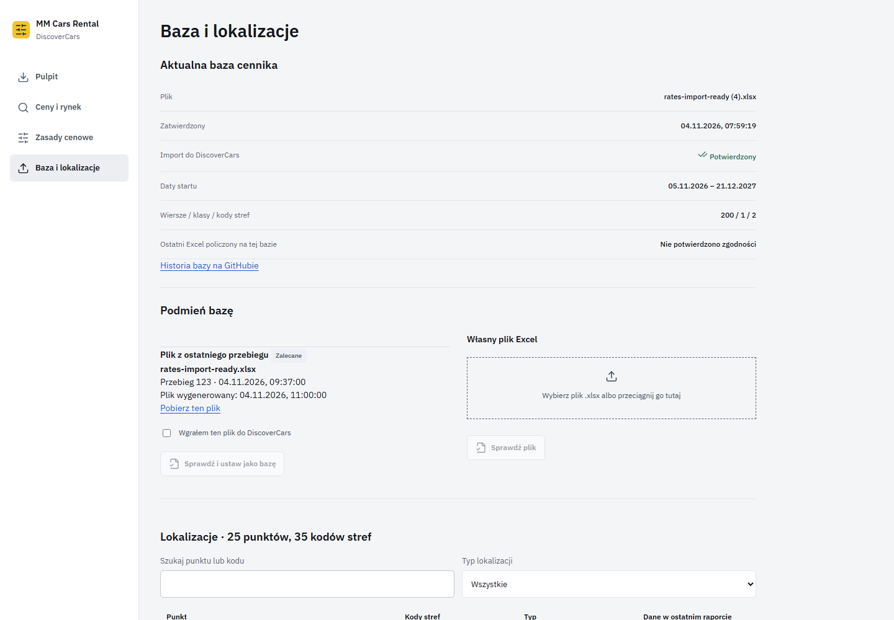 | 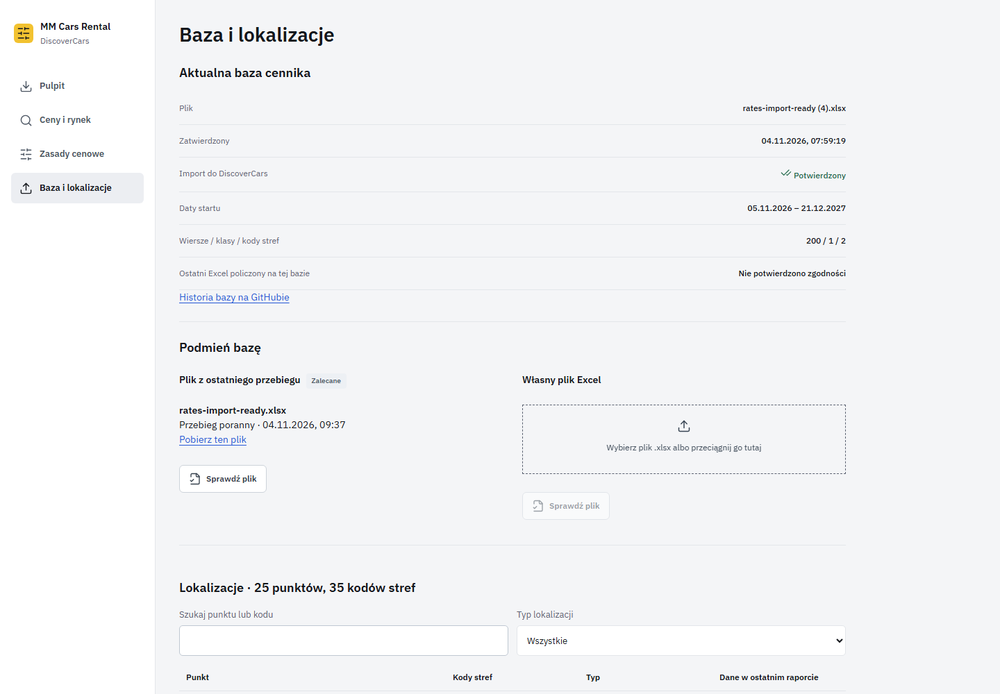 |

### start 390px

| Before | After |
|---|---|
| 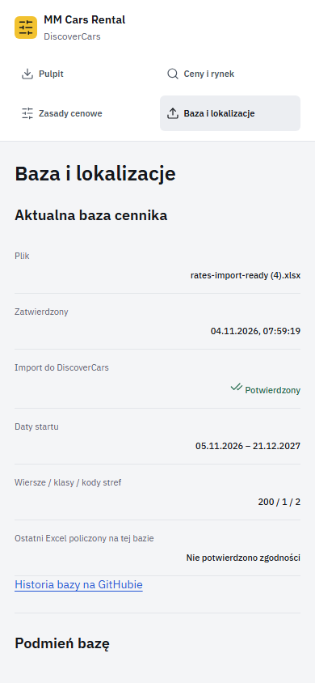 | 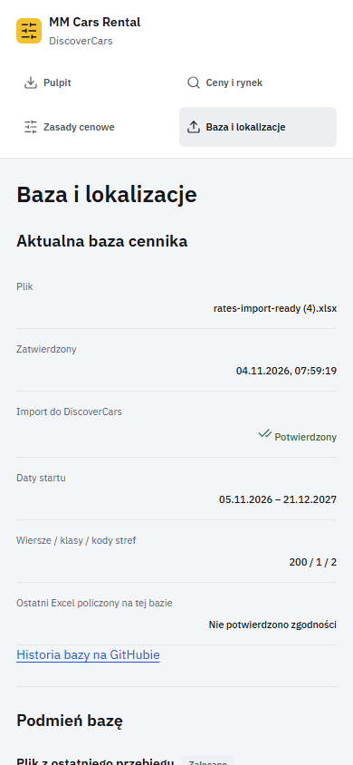 |

### report-checked 1440px

| Before | After |
|---|---|
| 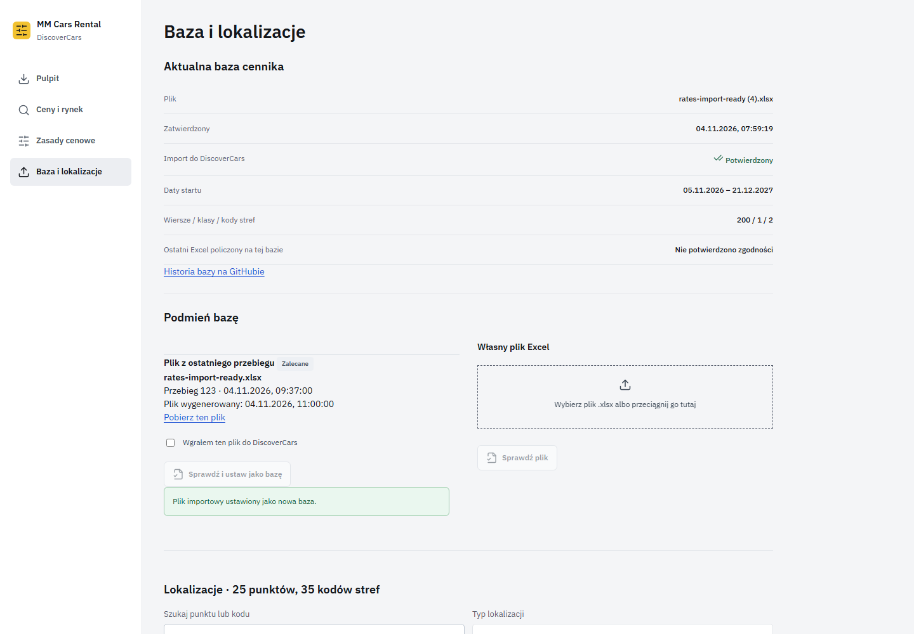 | 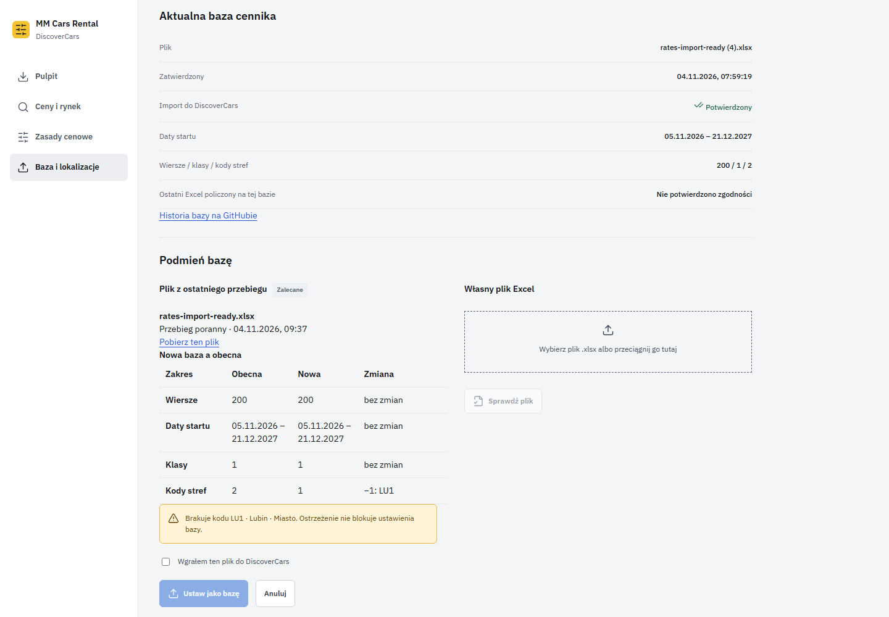 |

### report-checked 390px

| Before | After |
|---|---|
| 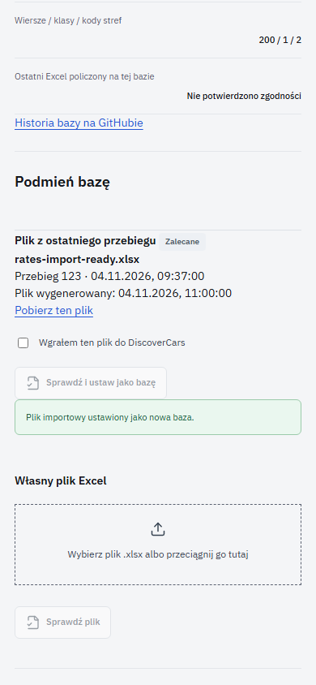 | 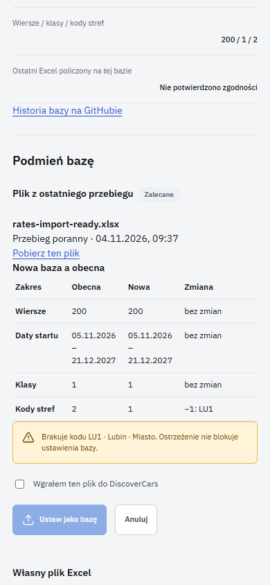 |

### new-codes 1440px

| Before | After |
|---|---|
| 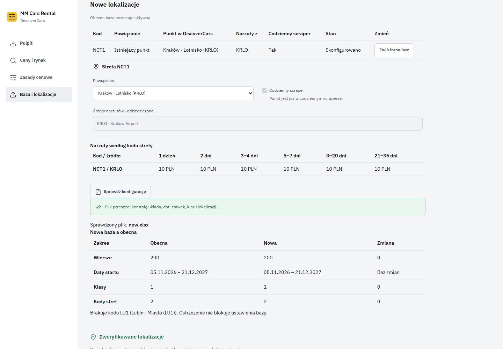 | 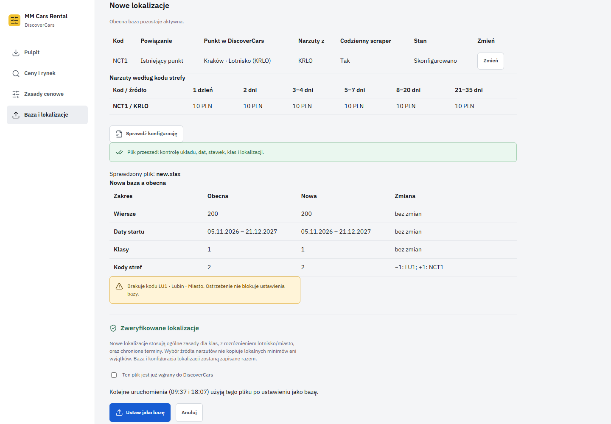 |

### new-codes 390px

| Before | After |
|---|---|
| 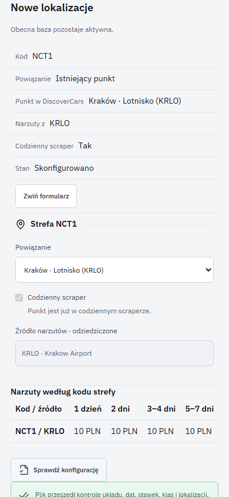 | 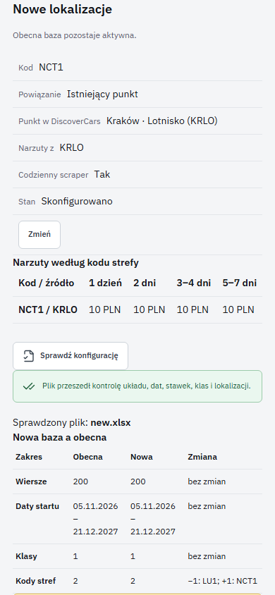 |
