# Rules follow-up UI

Base: `76621a1`. UI-only; policy.mjs, configuration, scraper and Excel export unchanged.

## Scope

Protected calendar cells display the lock and applicable minimum; null minima are never exceptional. Rule month navigation uses a Polish label. Family and ordinary desktop rows share columns. Polish plural forms, number grouping, bands and overlap labels are corrected. Impact examples identify branches and source time; branch counts and mean differences derived from samples are explicitly labelled as sample statistics, not whole-workbook estimates.

Duration warnings use the existing previewPolicy for all six bands, today and twelve following month starts, per zone and group. They run in a browser Worker and do not alter policy validation or publication guards. Omitted and missing-floor positions are excluded from comparisons. Adjacent longer bands with higher minima are grouped by identical affected zones/classes and sampled dates. Existing versus new warnings are compared using stable presentation keys. The dates checked are shown; this is not a guarantee for unsampled dates.

Performance: one full model scan took about 76 seconds locally. A changed draft requires two scans. Identical source/draft documents reuse one scan. The UI remains responsive and publication remains independent; results are discarded on context change. No API endpoints or requests added.

## Verification

Unit tests: 382/382 passed in the final clean serial run. All 22 Playwright scripts passed across staged runs; build and diff checks passed. Earlier environment/cache and under-load timeouts were rerun without weakening assertions. UI assertions include the exact FVMD/KRLO/3-4-day minimum of 600 on 20 December 2026, no exceptional null minima, aligned column coordinates, Polish source timestamp and accessible labels. Existing tests retain protected-date, no-write, exact-rate and responsive assertions; only month input operations became arrow navigation.

## Before / After

Controlled workspace fixture, 1440x1000 and 390x844. Screenshots are not a current pricing recommendation. The baseline capture uses the clean merged PR #3 checkout (no pricing or layout changes relevant to these captures between that checkout and the date-edit addition).

### calendar 1440

| Before | After |
|---|---|
| 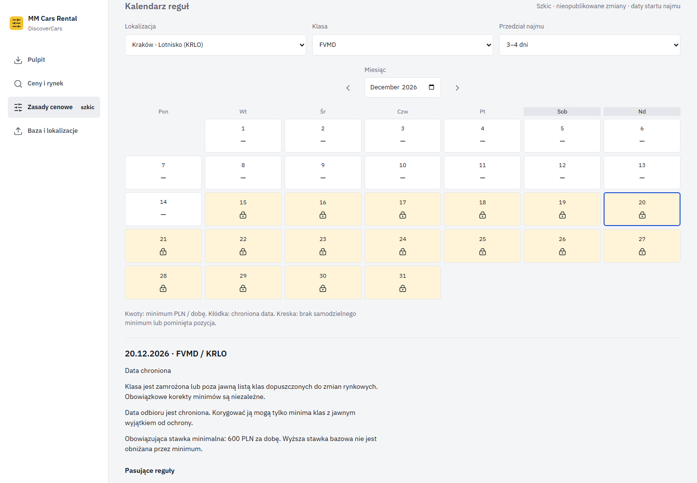 | 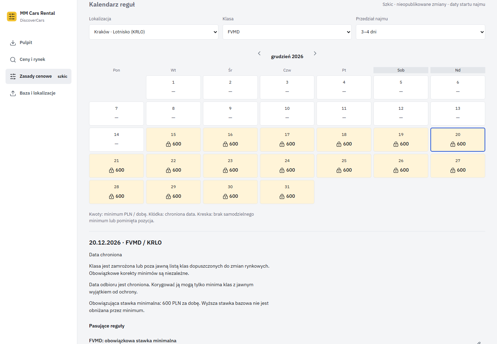 |

### calendar 390

| Before | After |
|---|---|
| 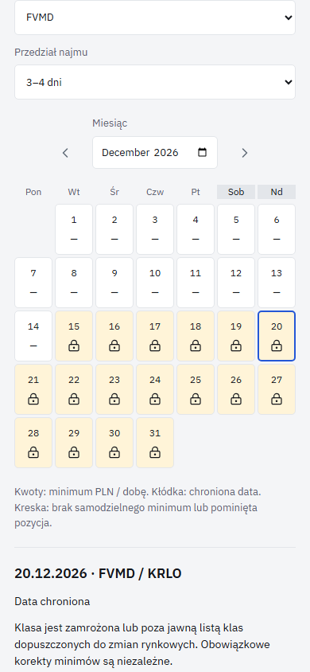 | 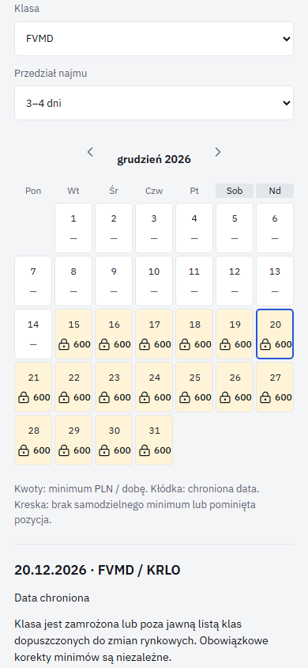 |

### list 1440

| Before | After |
|---|---|
| 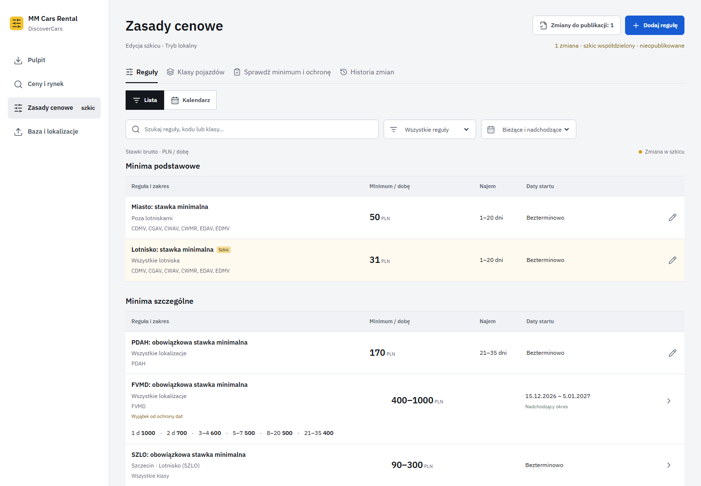 | 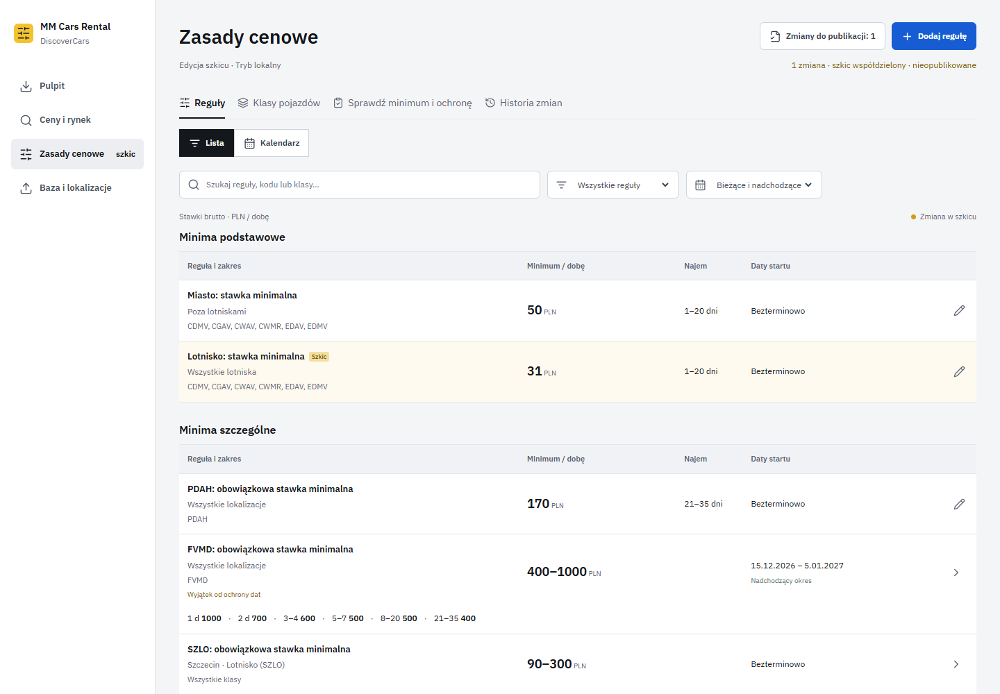 |

### list 390

| Before | After |
|---|---|
|  |  |

### family 1440

| Before | After |
|---|---|
| 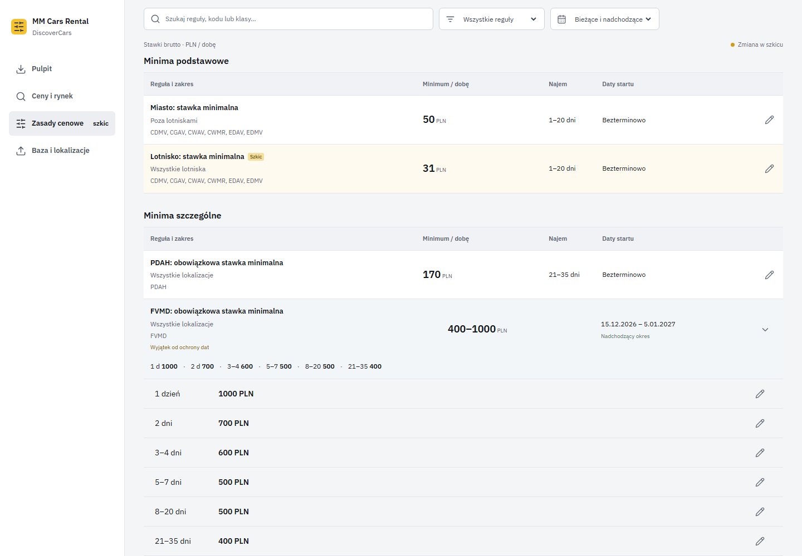 | 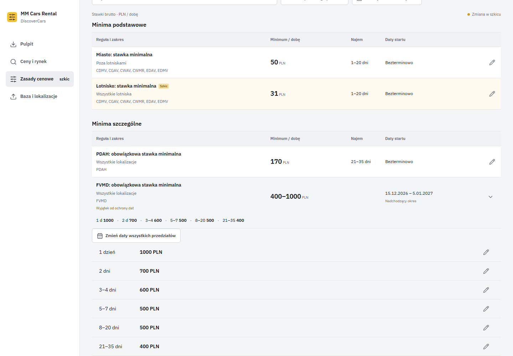 |

### family 390

| Before | After |
|---|---|
| 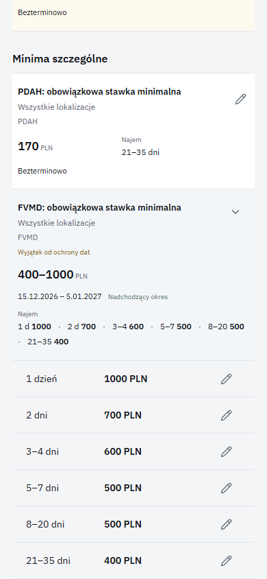 | 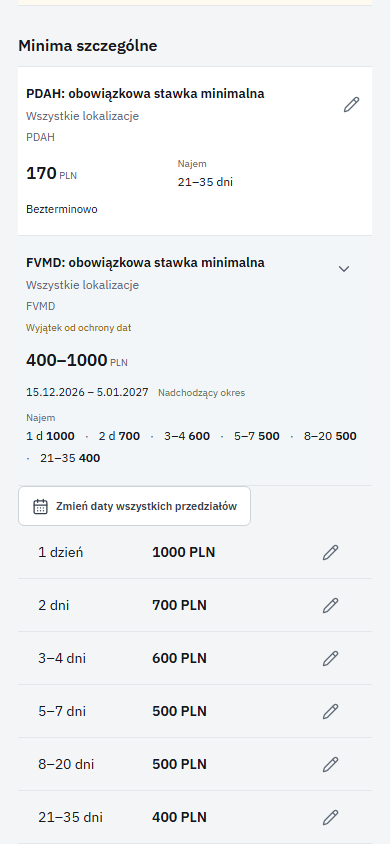 |

### review 1440

| Before | After |
|---|---|
| 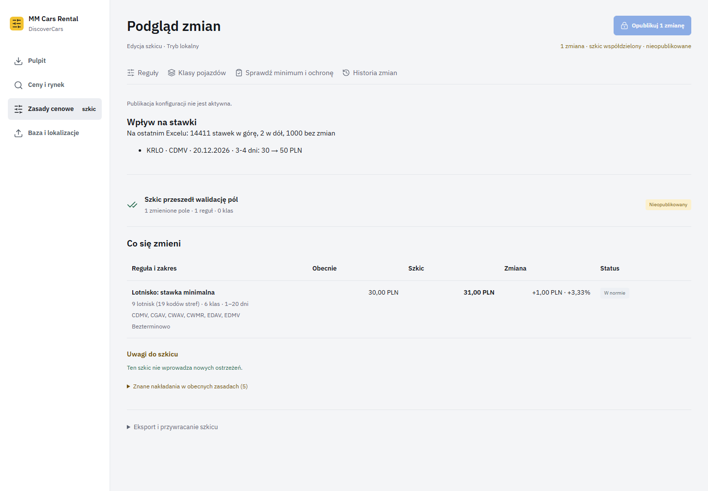 | 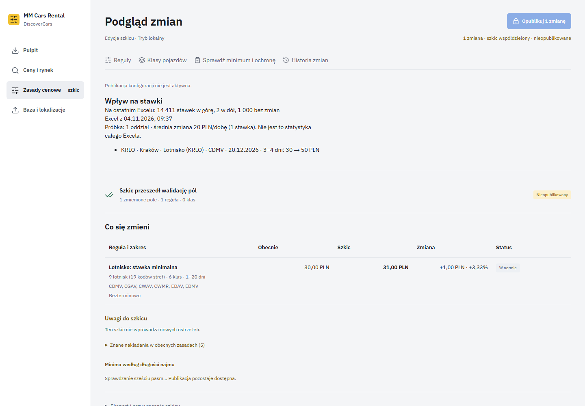 |

### review 390

| Before | After |
|---|---|
|  |  |

### warnings 1440

| Before | After |
|---|---|
|  | 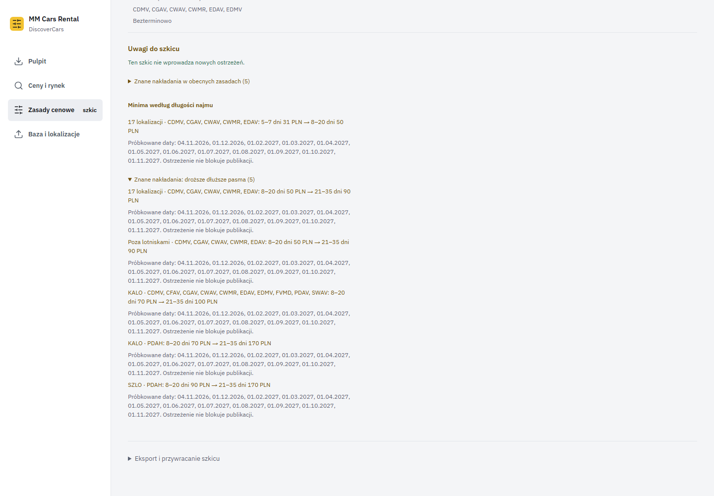 |

### warnings 390

| Before | After |
|---|---|
| 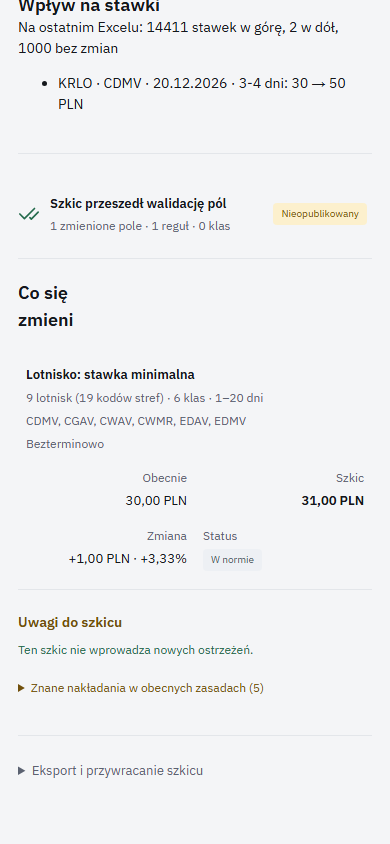 | 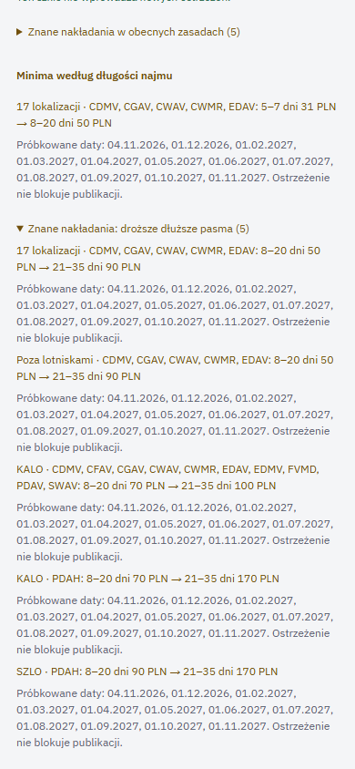 |
